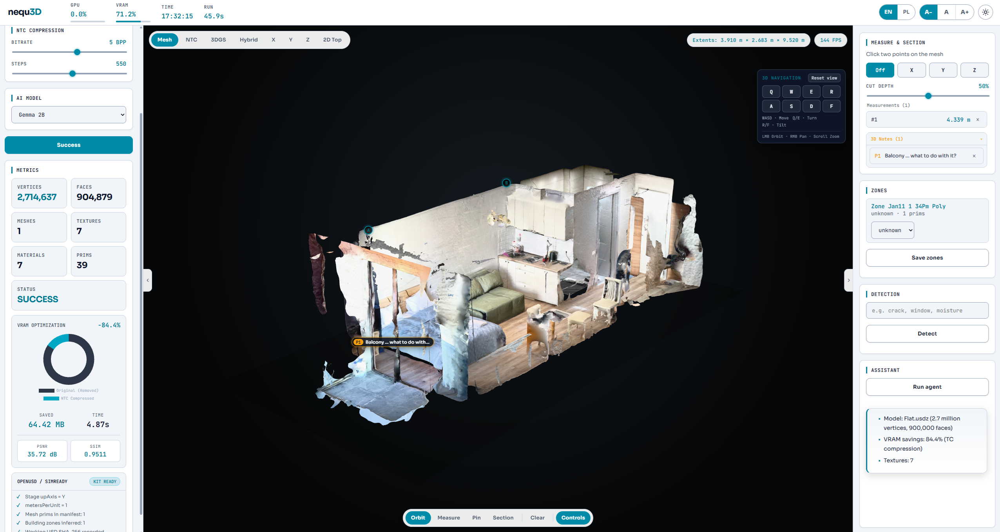

<h1 align="center">Nequ3D — Building Renovation Digital Twin</h1>

<div align="center">
  
  <p>
    <strong>Reality Scan (USDZ) → OpenUSD &amp; NVIDIA RTX NTC → Hybrid Mesh / 3DGS Inspection → Local AI Renovation Agent → Omniverse Kit</strong>
  </p>
</div>



## Architecture & Tech Stack

| Layer | Technology | Role |
| --- | --- | --- |
| **Frontend & 3D** |     | WebView2 workstation, Mesh / NTC / 3DGS / Hybrid split view, metric measure, XYZ section, 2D Top View & persistent 3D pins |
| **Desktop Edge** |   | Native Windows shell, capability-token preview server, GPU telemetry & tool-using AI orchestrator |
| **3D & Neural Core** |     | OpenUSD stage traversal, neural texture compression (`ntc-cli`), PSNR/SSIM metrics & `annotations.usda` layers |
| **RPC & Events** |    | Streaming Edge ↔ Core pipeline RPC & persistent digital-twin event timeline |
| **Provenance & OCI** |    | DSSE-signed `SLSA v1` attestations, OCI twin manifests & S3 buckets (`raw-scans` / `processed-models`) |
| **Offline AI & Evals** |    | Local LLM planner/advisor (`gemma:2b` / `llama3` / `llava`), numerical faithfulness judge & optional vision detection |
| **Containers & K8s** |      | `nequ3d-core:v4` CUDA container, Helm packaging & scale-to-zero `ScaledObject` |
| **GitOps & NetSecOps** |      | GitOps sync, encrypted secrets, admission policies, eBPF runtime shield & CycloneDX SBOM ([threat model](docs/security-threat-model.md)) |
| **Observability** |     | End-to-end W3C trace propagation (Edge → gRPC → Core), Prometheus gauges & Grafana dashboards |
| **Research & CI** |    | Reactive RTX NTC rate-distortion & LaTeX `booktabs` notebook (`task notebook`) + automated CI |

## Quick Start (Windows + NVIDIA GPU)

**Prerequisites:** PowerShell 7, Go 1.26+, Node.js 22+, Edge WebView2, Docker Desktop (or Podman 5+) with NVIDIA GPU passthrough, `kubectl` with a local Kubernetes cluster (`docker-desktop` / `k3s` / `k3d`), and optional [Task](https://taskfile.dev/) + [Ollama](https://ollama.com/) (`ollama pull gemma:2b`).

```powershell
# 1) Install Wails v3 CLI (one-time)
go install github.com/wailsapp/wails/v3/cmd/wails3@v3.1.0

# 2) Launch everything (MinIO, GPU Core, Jaeger/Grafana/Prometheus/Argo UIs, NATS JetStream & Wails app)
task run-all
# First run or after Python/Dockerfile edits:
task run-all-build
```

<details>
<summary><strong>First-time Kubernetes MinIO bootstrap, Podman &amp; Windows Smart App Control notes</strong></summary>

```powershell
# Bootstrap MinIO namespace, credentials secret, and deployment on a fresh local K8s cluster:
kubectl create namespace minio --dry-run=client -o yaml | kubectl apply -f -
kubectl -n minio create secret generic minio-credentials `
  --from-literal=rootUser=minioadmin `
  --from-literal=rootPassword=minioadmin `
  --dry-run=client -o yaml | kubectl apply -f -
kubectl apply -f gitops/apps/minio-standalone.yaml
```

- **Without `task`:** `pwsh -NoProfile -File ./scripts/run-all.ps1 -WithStack` (add `-BuildCore`, `-NoStack`, or `-WithLocate` as needed).
- **Podman:** set `$env:NEQU3D_CONTAINER_CLI = 'podman'` if Docker is also installed; Core reaches host forwards via `host.containers.internal`.
- **Windows Smart App Control:** if unsigned local Go binaries (`wails3.exe`) are blocked, the launcher automatically falls back to `go run`; disable Smart App Control if `go.exe` itself is blocked.

</details>

## Workflow

1. **Load file** (`.usdz` / `.usd` / `.glb` / `.ply` / `.splat`) → click **Analyze** to run OpenUSD parsing, RTX NTC compression, 3DGS surfel generation, SimReady validation, and `in-toto` attestation.
2. Inspect in **Mesh**, **NTC** (32bpp vs NTC split), **3DGS**, or **Hybrid** (Mesh / 3DGS split), take metric **Measurements**, cut **XYZ Sections**, toggle **2D Top** view, and pin persistent **3D Notes**.
3. Set zone renovation statuses and click **Save zones** (`twin_manifest.json` + `annotations.usda` + refreshed DSSE signature & CloudEvent).
4. Click **Run agent** (local Ollama + automatic numerical faithfulness evaluation) or open `exports/omniverse/<asset>/building_twin.usda` directly in **NVIDIA Omniverse Kit**.

## Key Commands & Ports

| Command | Action |
| --- | --- |
| `task run-all` / `task run-all-lite` | Full stack with CNCF UIs / Lite session (`-NoStack`) |
| `task run-all-build` | Rebuild `nequ3d-core:v4` + start full session |
| `task run-all-locate` | Full session + optional LocateAnything (`:8000`, ≥12 GB VRAM) |
| `task benchmark-sweep` | Multi-BPP / multi-step RTX NTC benchmark (`experiments/results/`) |
| `task notebook` | Reactive `marimo` Rate–Distortion & LaTeX table notebook |
| `task security-audit` | Verify Kyverno policies, Tetragon eBPF, KEDA & build CycloneDX SBOM |
| `task oras-dryrun TWIN_DIR=...` | Validate OCI / ORAS twin layers & `in-toto` provenance bundle |

| Service | Local Endpoint |
| --- | --- |
| Nequ3D Vite / Dev UI | `127.0.0.1:9245` |
| Core gRPC / Metrics | `127.0.0.1:50051` / `127.0.0.1:8001/metrics` |
| MinIO S3 API / Console | `127.0.0.1:9000` / `127.0.0.1:9001` |
| Jaeger UI / OTLP HTTP | `127.0.0.1:16686` / `127.0.0.1:4318` |
| Grafana / Prometheus / Argo CD | `127.0.0.1:3000` / `127.0.0.1:9090` / `127.0.0.1:8080` |
| Ollama / LocateAnything | `127.0.0.1:11434` / `127.0.0.1:8000` |

## Repository Layout

```text
nequ3d-app/       Wails v3.1 Go Edge, NATS JetStream, OTel, in-toto/AI verifiers & TypeScript UI
nequ3d-core/      CUDA/Python gRPC server, OpenUSD, NVIDIA RTX NTC, 2DGS & Omniverse packager
proto/            Protobuf pipeline contract
gitops/, helm/    Argo CD apps, Helm chart, KEDA scaler, Kyverno & Tetragon eBPF policies
experiments/      RTX NTC benchmark harness & reactive marimo thesis notebook
scripts/          One-command Windows launcher, ORAS packager, marimo bootstrap & NetSecOps audit
docs/             Dashboard preview & NetSecOps / eBPF threat model
ml-services/      Optional LocateAnything vision microservice
```

## License

Apache License 2.0 — see [LICENSE](LICENSE). Third-party components retain their respective licenses.
