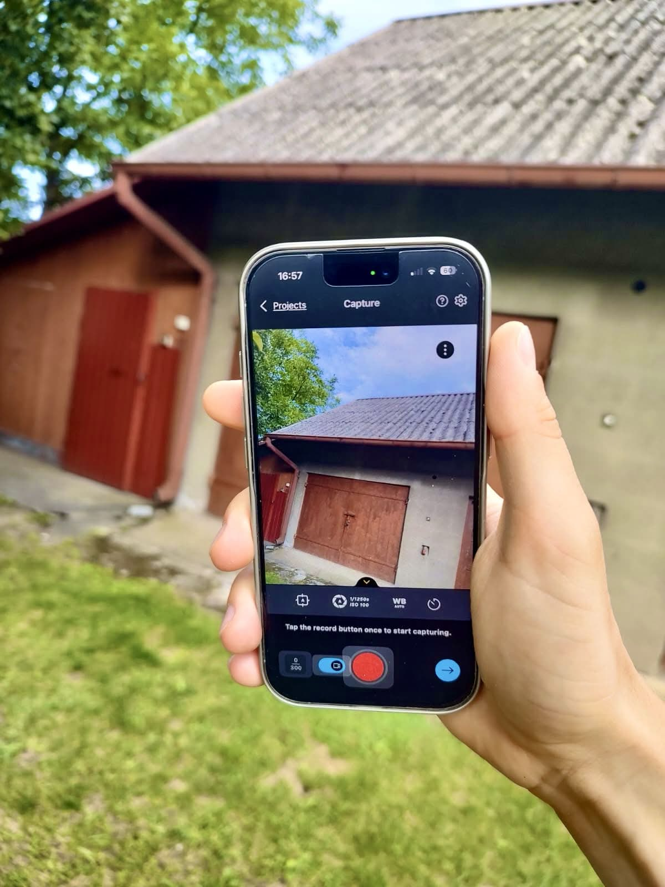
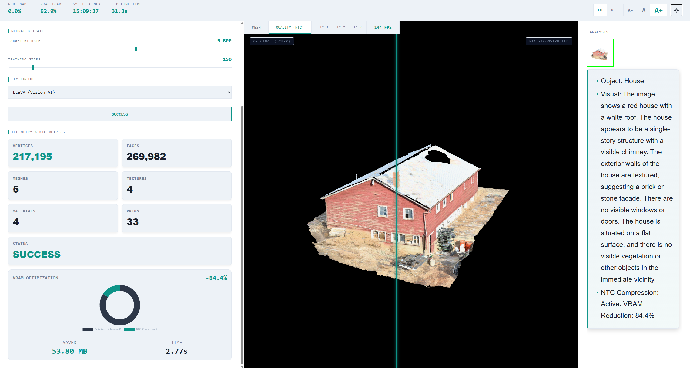

# Nequ3D — OpenUSD Edge-to-Core Pipeline

<div align="center">
  
</div>

Nequ3D is a research application for inspecting captured 3D assets, processing OpenUSD scenes, measuring GPU telemetry, and compressing UV textures with NVIDIA RTX Neural Texture Compression (NTC). The desktop interface supports English and Polish. Local AI reports use Ollama.

**Supported local workflow: Windows + NVIDIA GPU.** The Wails desktop application runs on Windows; the Python processing Core runs in a Linux Docker container. MinIO runs in the local Kubernetes cluster and is exposed by the launcher. Docker does not contain the desktop window.

## Prerequisites

Install and make available on `PATH`:

- Windows with [PowerShell 7](https://learn.microsoft.com/powershell/scripting/install/installing-powershell-on-windows).
- [Go 1.26+](https://go.dev/dl/) (see `nequ3d-app/go.mod`).
- [Node.js 22.12+](https://nodejs.org/en/download) and npm for the Vite frontend.
- [Wails v3 CLI](https://v3.wails.io/) and Microsoft Edge WebView2 Runtime. The Go application uses Wails `v3.0.0-alpha.97`; the launcher was verified with CLI `v3.0.0-beta.16`:

  ```powershell
  go install github.com/wailsapp/wails/v3/cmd/wails3@v3.0.0-beta.16
  ```

- [Docker Desktop](https://www.docker.com/products/docker-desktop/) running Linux containers with the WSL 2 backend and GPU support; NVIDIA Windows drivers.
- `kubectl` and a running local Kubernetes cluster selected in its current context.
- A healthy MinIO deployment named `minio`, service `minio`, in namespace `minio`. The launcher reads credentials from the existing Kubernetes secret and passes them to Go and Core as environment variables; credentials are not embedded in source. The manifest is `gitops/apps/minio-standalone.yaml`, and it requires the `minio-credentials` secret (`rootUser`, `rootPassword`). The launcher forwards this existing deployment; it does not install Kubernetes or overwrite MinIO data.
- Optional: [Task](https://taskfile.dev/installation/) for the short commands below.

MinIO's manifest currently references `minio/minio:latest` with `IfNotPresent`. This machine can use its cached Kubernetes image, but a fresh installation must supply an available MinIO image. If a pod reports `ImagePullBackOff`, resolve the image in the deployment before launching; a service object alone does not mean MinIO is ready.

## Start everything

From the repository root in PowerShell 7:

```powershell
task run-all
```

Without Task (also works from another directory when given the full script path):

```powershell
pwsh -NoProfile -File ./scripts/run-all.ps1
```

`task dev` is an alias for `task run-all`. The launcher:

1. Checks required tools, Docker, MinIO availability, and free ports.
2. Builds `nequ3d-core:v4` if that image is missing; otherwise reuses it.
3. Starts a hidden MinIO port-forward on `127.0.0.1:9000`.
4. Starts Core with NVIDIA GPU access and mounts `data/objects` at `/tmp/workspace`.
5. Checks MinIO HTTP health, Core metrics, TCP connectivity to the gRPC port, and GPU access. This does not run a processing RPC.
6. Generates Wails bindings and runs `wails3 dev`, including frontend setup and the desktop application.
7. On normal exit, interruption, or launch failure, stops its Core container and its port-forward. The MinIO deployment stays running.

Keep the launcher terminal open. Stop the session with **Ctrl+C** there. Do not run a second session on the same ports. Logs are in `data/logs`; Core logs are saved on shutdown.

After changes to Core's Python files or Dockerfile, explicitly rebuild:

```powershell
pwsh -NoProfile -File ./scripts/run-all.ps1 -BuildCore
```

Check prerequisites without starting services:

```powershell
pwsh -NoProfile -File ./scripts/run-all.ps1 -CheckOnly
```

## Optional AI reports

Install Ollama and download only the models you intend to use:

```powershell
ollama pull gemma:2b
# Optional alternatives:
ollama pull llama3
ollama pull mistral
ollama pull llava
```

Ollama must listen on `localhost:11434`. It is managed separately and is not stopped by the launcher. The application defaults to `gemma:2b`, not `gemma2`.

## Development commands

| Command | Purpose |
| --- | --- |
| `task run-all` / `task dev` | Complete Windows development session |
| `task build-core` | Rebuild the same `nequ3d-core:v4` image |
| `task dev-app` | Desktop only; assumes Core and MinIO are already running |
| `task run-core` | Core only in the current terminal; create `data/objects` first and provide MinIO separately |
| `task proto` | Regenerate Go/Python RPC code after editing `proto/`; requires Python and downloads generation tools |
| `wails3 build` in `nequ3d-app` | Build the desktop executable in `nequ3d-app/bin`; services remain external |

For manual `task dev-app` or `task run-core`, set `MINIO_ACCESS_KEY` and `MINIO_SECRET_KEY` in that terminal first (use the existing MinIO credentials). `task run-all` supplies them automatically. `NEQU3D_CORE_ADDR` overrides the shared Go gRPC target (default `127.0.0.1:50051`); LocateObjects additionally requires its separate HTTP microservice and is not started by the launcher.

Python is needed on the host for `task proto`, not for ordinary startup. Generated RPC files are committed. Frontend dependencies use `npm ci`; startup does not run `npm audit fix` or intentionally change dependency versions.

## Ports and troubleshooting

| Service | Local port |
| --- | --- |
| MinIO API | 9000 |
| Core gRPC | 50051 |
| Core Prometheus metrics | 8001 |
| Vite development server | 9245 |
| Ollama (optional) | 11434 |

- **Port already in use:** stop the previous launcher/session. The launcher fails instead of killing unrelated processes or containers.
- **MinIO unavailable:** inspect `kubectl get pods -n minio` and `kubectl describe pod -n minio <pod-name>`. Check credentials, the selected context, and image availability. For the existing cached `latest` image use `imagePullPolicy: IfNotPresent`.
- **Core/GPU failure:** inspect `data/logs/core.log`, Docker Desktop, and NVIDIA drivers. This workflow requires GPU access; there is no automatic CPU fallback for NTC.
- **Flashing terminal:** use the current application source, which hides the Windows console for periodic `nvidia-smi` telemetry calls.
- **Old Core behavior:** restart with `-BuildCore`; reusing an image does not rebuild it from changed source.
- **Hard termination:** if the terminal is killed rather than interrupted, cleanup may not execute. Inspect `docker ps` and the recorded port-forward process before stopping the remaining session manually.

## Repository structure

```text
nequ3d-app/       Go/Wails desktop backend and TypeScript frontend
nequ3d-core/      Python gRPC processing, OpenUSD, and Core Dockerfile
proto/           Shared RPC definitions
scripts/         Windows launcher and RPC generation scripts
gitops/, helm/   Kubernetes, GitOps, and monitoring configuration
ml-services/     Additional ML service sources
data/            Local objects and logs (ignored by Git)
docs/            Screenshots
```

The Core Dockerfile clones RTXNTC itself. The local `nequ3d-core/RTXNTC` gitlink currently lacks a root `.gitmodules` mapping; ordinary Docker startup does not depend on initializing that checkout. Do not discard local changes there when updating the project.




## License

See [LICENSE](LICENSE) (Apache License 2.0). Third-party components have their own licenses.
