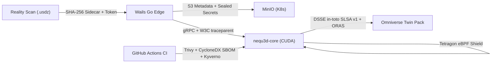

# Nequ3D — Threat Model, Supply-Chain Provenance & eBPF Runtime Security

Reality Scan captures of residential and commercial interiors contain sensitive spatial and structural data. At the same time, 3D container formats (`.usdz` ZIP archives, `.usd`/`.usda`, `.glb`, embedded textures) are complex binary/ASCII inputs parsed by native C++/CUDA libraries (`pxr` OpenUSD, `ntc-cli`, `trimesh`).

Nequ3D applies a layered **Cloud-Native NetSecOps (Defense-in-Depth)** architecture with zero cloud data exfiltration:

---

## 1. Edge & Data Confidentiality Controls

| Threat | Control | Implementation |
| --- | --- | --- |
| Arbitrary local file read from WebView2 | Per-session cryptographic capability token (`rand.Text()`) + explicit path allowlist + symlink canonicalization | `nequ3d-app/preview.go` |
| Cloud LLM data leakage of private interiors | 100% local inference via Ollama (`127.0.0.1:11434`) + offline deterministic fallback | `nequ3d-app/app.go`, `nequ3d-app/agent.go` |
| Silent corruption / tampering of raw scans | SHA-256 sidecar (`*.sha256.json`) + MinIO `x-amz-meta-sha256` & `x-amz-meta-trace-id` | `nequ3d-app/twin.go`, `nequ3d-core/integrity.py` |
| Plaintext credentials in GitOps repo | Bitnami **Sealed Secrets** (`SealedSecret` CRD) + runtime Kubernetes Secret injection | `gitops/apps/minio-sealed-secret.yaml` |

---

## 2. Supply-Chain Integrity: in-toto (`SLSA v1.0`), ORAS & CycloneDX SBOM

1. **DSSE-signed `in-toto` Attestations (`CNCF Graduated`)**:
   - Every exported twin directory (`exports/omniverse/<asset>/`) includes `provenance.intoto.jsonl` — a Dead Simple Signing Envelope (`application/vnd.in-toto+json`) wrapping an `https://in-toto.io/Statement/v1` statement with a `https://slsa.dev/provenance/v1` predicate.
   - Binds the source `.usdz` SHA-256, `ntc-cli` parameters (`target_bpp`, `training_steps`), and OpenTelemetry `invocationId` (`trace_id`) to the exact SHA-256 digests of `building_twin.usda`, `annotations.usda`, `twin_manifest.json`, and `.glb` proxies.
   - Live tamper detection is available directly in the Nequ3D UI (**Re-verify SHA-256** -> `VerifyTwinProvenance`).
2. **OCI Artifact Packaging via ORAS (`CNCF Sandbox`)**:
   - `oras_artifact_manifest.json` + `scripts/push-oras-twin.ps1` package OpenUSD layers (`model/vnd.usd+usda`), RTX NTC payloads (`application/vnd.nvidia.rtxntc`), and `in-toto` attestations as OCI v1.1 artifacts.
3. **Trivy Vulnerability Audit & CycloneDX SBOM**:
   - CI (`netsecops-audit` in `.github/workflows/ci.yml`) and local `task security-audit` (`scripts/verify-netsecops.py`) audit Kubernetes manifests and generate a **CycloneDX 1.5 SBOM** covering Go, Python, and npm dependencies.

---

## 3. Admission & Runtime Enforcement: Kyverno, Tetragon eBPF & Shirudo

1. **Admission Policy-as-Code (`Kyverno` — `CNCF Incubating`)**:
   - `gitops/policies/kyverno-nequ3d-policies.yaml` enforces Pod Security invariants across `nequ3d-core`, `jaeger`, and `minio`: `allowPrivilegeEscalation: false`, `capabilities.drop: ["ALL"]`, pinned image tags (`!*:latest`), and mandatory memory limits.
2. **Kernel Runtime Sandboxing (`Tetragon` eBPF — `CNCF` / Cilium)**:
   - Parsing untrusted 3D archives (`.usdz` / `.glb`) in C++ libraries carries memory-safety risk.
   - `gitops/policies/tetragon-nequ3d-core-shield.yaml` attaches Linux kernel `kprobes` (`sys_execve` and `security_file_open`) to `nequ3d-core` pods, immediately sending `SIGKILL` if a compromised parser attempts to spawn `/bin/sh`, `/bin/bash`, `curl`, `wget`, `nc`, or read Kubernetes service-account tokens.
3. **Architectural Evolution toward Agentic eBPF Shields (`Shirudo`)**:
   - In November 2026, OpenAI and Cisco/Isovalent introduced **Shirudo** (`shirudo-dev/shirudo`), evolving Tetragon's eBPF enforcement into AI-authored, cryptographically signed kernel micro-shields (*upatches*) distributed as OCI artifacts and measured into hardware **TPM 2.0** PCRs.
   - While Shirudo requires a custom-patched native Linux kernel (`bpf-next`) with hardware Measured Boot (making standard `TracingPolicy` in **Tetragon** the portable choice for WSL2 / Docker Desktop / managed Kubernetes clusters), Nequ3D already implements both foundational pillars of the Shirudo model:
     1. **eBPF syscall/file containment** via Tetragon (`tetragon-nequ3d-core-shield.yaml`), and
     2. **DSSE-signed OCI security artifacts** via `in-toto` + `ORAS` (`provenance.intoto.jsonl`).

---

## 4. Event-Driven GPU FinOps: KEDA (`CNCF Graduated`)

GPU worker nodes are expensive when idle. Enabling `keda.enabled=true` in `helm/nequ3d-core/values.yaml` deploys `helm/nequ3d-core/templates/keda-scaledobject.yaml`, scaling `nequ3d-core` replicas from **`0` (scale-to-zero)** up to `maxReplicaCount` based on:
- Live Prometheus metric `sum(nequ3d_active_grpc_requests)` (`:8001/metrics`), and
- Optional **NATS JetStream** consumer lag on stream `NEQU3D_TWIN_EVENTS`.
